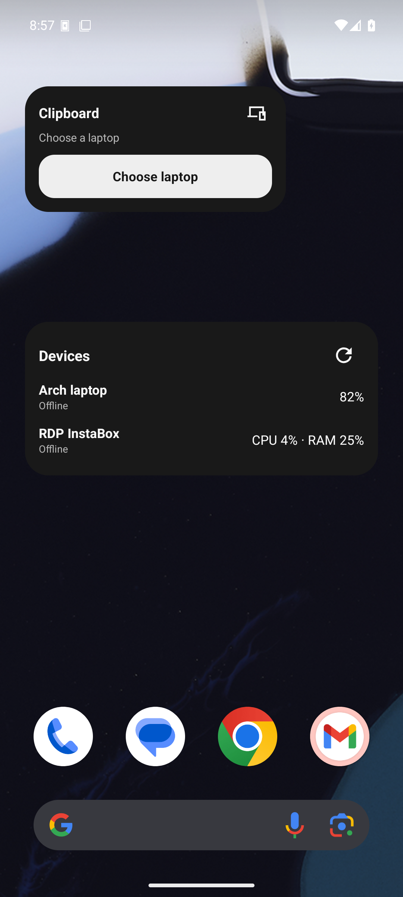

# Pingly

An Android companion for your Linux laptop. Mirror notifications, send clipboard text, images, and files, and check laptop status from your phone’s home screen.

[Download for Android and Linux](https://github.com/wrestle-R/Pingly/releases/latest) · [Website](https://pingly-seven.vercel.app) · [Report an issue](https://github.com/wrestle-R/Pingly/issues)

*Android development preview with sample device readings.*

The Linux package targets Arch-based x86_64 systems. The Android release has been tested on Android 16. If you already have a newer build, keep it to avoid an Android downgrade.

[Widget guide](docs/widgets.md) · [Desktop licensing](tauri/COPYING) · [Native source](tauri/native/source.json)

Pingly reuses parts of KDE Connect and preserves their original notices.
